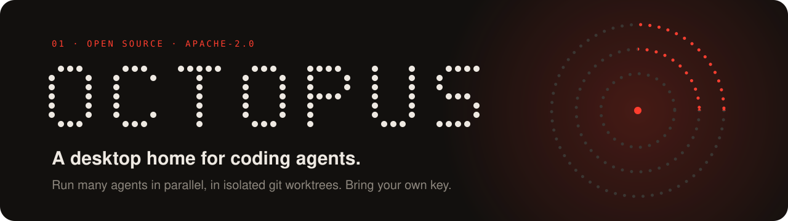
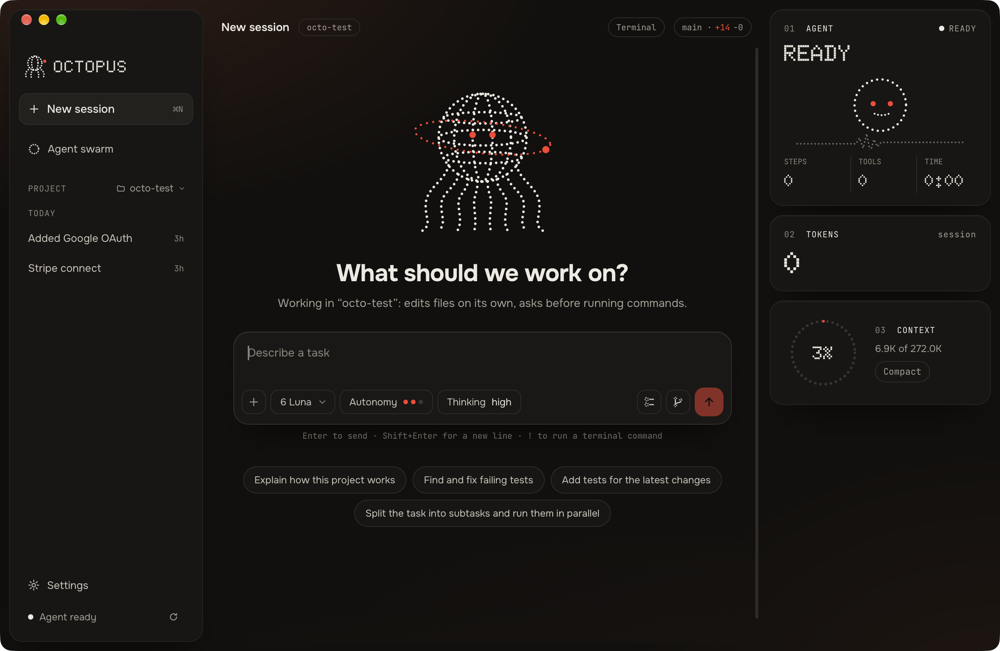

<p align="center">
  
</p>

<p align="center">
  <a href="https://github.com/SkvorikovCode/Octopus-AI/stargazers"></a>
  <a href="https://github.com/SkvorikovCode/Octopus-AI/releases/latest"></a>
  <a href="LICENSE"></a>
  <a href="https://github.com/SkvorikovCode/Octopus-AI/actions/workflows/ci.yml"></a>
  
  
  <a href="CONTRIBUTING.md"></a>
</p>

<p align="center">
  <a href="https://github.com/SkvorikovCode/Octopus-AI/releases/latest"><b>Download for macOS</b></a> · <b>English</b> · <a href="README.ru.md">Русский</a> · <a href="https://skvorikovcode.github.io/Octopus-AI/">Website</a>
</p>

# Octopus AI

A desktop app for working with coding agents without living in a terminal.
Open a project, describe what you want, and watch one agent — or a whole swarm —
do the work in isolated git worktrees, while you review plain-language
permission cards and a clean diff instead of a wall of logs.

Octopus is **bring-your-own-key** today: your keys stay in the OS keychain and
your code never leaves your machine except for the calls your chosen provider
needs. Our goal is to grow it into something you can also run on shared
infrastructure built for agents, funded by the community rather than resold
from somebody else's subscription.

> **Status: early.** It works and it is moving fast, but expect rough edges and
> breaking changes before 1.0. Issues and feedback are very welcome.

<p align="center">
  
</p>

## What it does

- **Chat with an agent** in your project folder, with tool steps collapsed by
  default and depth on demand.
- **Swarm dashboard** — run several agents in parallel, each in its own git
  worktree so they never trip over each other.
- **Checkpoints and changes** — see what the agent touched, review the diff,
  commit from the app.
- **Permission cards** written for humans: what the agent wants to do and why.
- **Rules and instructions** — per-project and global guidance the agent follows.
- **Built-in terminal** and file viewer next to the conversation.
- **Providers and budget** — connect your own provider keys (stored in the OS
  keychain), pick models, and keep an eye on spend.

## How it works

Octopus is a [Tauri 2](https://tauri.app) shell (Rust + React/TypeScript). The
agent engine is [oh-my-pi](https://github.com/can1357/oh-my-pi) (`omp`, MIT),
which Octopus launches as a separate process in RPC mode inside your project
folder and talks to over stdin/stdout.

| Path | What lives there |
| --- | --- |
| `src-tauri/src/omp.rs` | spawns the engine, relays protocol frames to the window |
| `src-tauri/src/keys.rs` | provider keys in the OS keychain |
| `src-tauri/src/worktrees.rs`, `gitops.rs` | isolated worktrees and git operations |
| `src/lib/omp.ts`, `src/lib/session.ts` | protocol client and chat/tile state |
| `src/components/` | the interface |

## Download

Get the `.dmg` from the [latest release](https://github.com/SkvorikovCode/Octopus-AI/releases/latest): Apple Silicon,
macOS 11+. The agent engine is bundled, and new versions arrive as in-app
updates.

The build is not signed by Apple yet. If macOS refuses to open it, go to
**System Settings → Privacy & Security** and press **Open Anyway** (needed
once). On first launch, sign in with a subscription you already have or add a
provider key.

## Run it from source

You need [Rust](https://rustup.rs), Node.js 20.19+ and the `omp` engine installed.

```sh
brew install omp        # or see https://github.com/can1357/oh-my-pi
npm install
npm run tauri dev
```

Release builds already include the engine; building from source uses the one you
installed. If no provider is configured yet, the app asks for a key on first
launch.

```sh
npm test                                  # frontend unit tests
npm run build                             # type-check + production bundle
cargo test --manifest-path src-tauri/Cargo.toml
```

## Contributing

We would love your help — start with [CONTRIBUTING.md](CONTRIBUTING.md). Good
first steps: try the app and file what felt wrong, pick an issue labelled
`good first issue`, or improve the docs.

Please read the [Code of Conduct](CODE_OF_CONDUCT.md). Found a security problem?
See [SECURITY.md](SECURITY.md) — do not open a public issue.

## Support the project

Octopus is built in the open. Donations go towards the thing that makes this
more than a wrapper: servers for coding agents, so you are not limited to
borrowed subscriptions. Funding links will appear here and in the repository's
**Sponsor** button once the Open Collective page is live, with a public ledger
of where the money goes.

## License

[Apache-2.0](LICENSE). Third-party notices are in [NOTICE](NOTICE).
