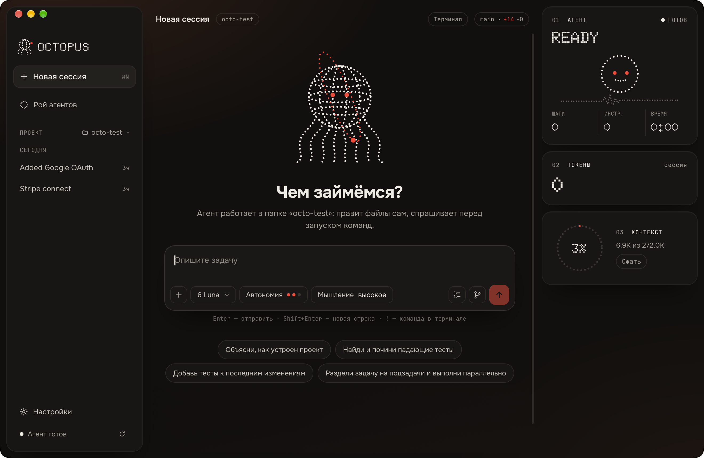

<p align="center">
  
</p>

<p align="center">
  <a href="README.md">English</a> · <b>Русский</b> · <a href="https://skvorikovcode.github.io/Octopus-AI/ru/">Сайт</a>
</p>

# Octopus AI

Десктопное приложение для работы с кодинг-агентами без жизни в терминале.
Открываете проект, описываете задачу — и один агент или целый рой работает в
изолированных git worktree, а вы смотрите на понятные карточки разрешений и
аккуратный diff вместо стены логов.

Сейчас Octopus работает по схеме **bring-your-own-key**: ключи лежат в системной
связке ключей, а код не покидает вашу машину, кроме запросов к выбранному
провайдеру. Цель — вырасти в сервис, который можно запускать и на общих
мощностях, собранных под агентов и оплаченных сообществом, а не перепродавать
чужие подписки.

> **Статус: ранний.** Работает и быстро развивается, но до 1.0 возможны шероховатости
> и ломающие изменения. Issues и обратная связь очень приветствуются.

<p align="center">
  
</p>

## Что умеет

- **Чат с агентом** в папке проекта: шаги инструментов свёрнуты, глубина — по запросу.
- **Панель роя** — несколько агентов параллельно, у каждого свой git worktree.
- **Контрольные точки и изменения** — что тронул агент, diff, коммит из приложения.
- **Карточки разрешений** человеческим языком: что хочет сделать агент и зачем.
- **Правила и инструкции** — общие и для проекта.
- **Встроенный терминал** и просмотр файлов рядом с диалогом.
- **Провайдеры и бюджет** — свои ключи (в связке ключей ОС), выбор моделей, контроль расходов.

## Как устроено

Octopus — оболочка на [Tauri 2](https://tauri.app) (Rust + React/TypeScript). Движок
агента — [oh-my-pi](https://github.com/can1357/oh-my-pi) (`omp`, MIT): Octopus
запускает его отдельным процессом в режиме RPC в папке проекта и общается через
stdin/stdout.

| Путь | Что там |
| --- | --- |
| `src-tauri/src/omp.rs` | запуск движка, передача кадров протокола в окно |
| `src-tauri/src/keys.rs` | ключи провайдеров в связке ключей ОС |
| `src-tauri/src/worktrees.rs`, `gitops.rs` | изолированные worktree и операции git |
| `src/lib/omp.ts`, `src/lib/session.ts` | клиент протокола и состояние чата/плиток |
| `src/components/` | интерфейс |

## Запуск из исходников

Нужны [Rust](https://rustup.rs), Node.js 20.19+ и установленный движок `omp`.

```sh
brew install omp        # или https://github.com/can1357/oh-my-pi
npm install
npm run tauri dev
```

В релизные сборки движок уже встроен; при сборке из исходников используется
установленный у вас. Если провайдер ещё не настроен, при первом запуске
приложение попросит ключ.

```sh
npm test                                  # юнит-тесты фронтенда
npm run build                             # проверка типов + сборка
cargo test --manifest-path src-tauri/Cargo.toml
```

## Участие

Будем рады помощи — начните с [CONTRIBUTING.md](CONTRIBUTING.md). Хорошие первые
шаги: попробовать приложение и описать, что показалось неудобным, взять задачу с
меткой `good first issue`, улучшить документацию.

Прочитайте [Кодекс поведения](CODE_OF_CONDUCT.md). Нашли уязвимость? См.
[SECURITY.md](SECURITY.md), публичный issue не открывайте.

## Поддержать проект

Octopus делается в открытую. Пожертвования пойдут на то, что отличает проект от
обёртки: серверы для кодинг-агентов, чтобы не зависеть от чужих подписок. Ссылки
появятся здесь и на кнопке **Sponsor** репозитория, когда заработает страница
Open Collective, с публичным отчётом о расходах.

## Лицензия

[Apache-2.0](LICENSE). Сторонние уведомления — в [NOTICE](NOTICE).
